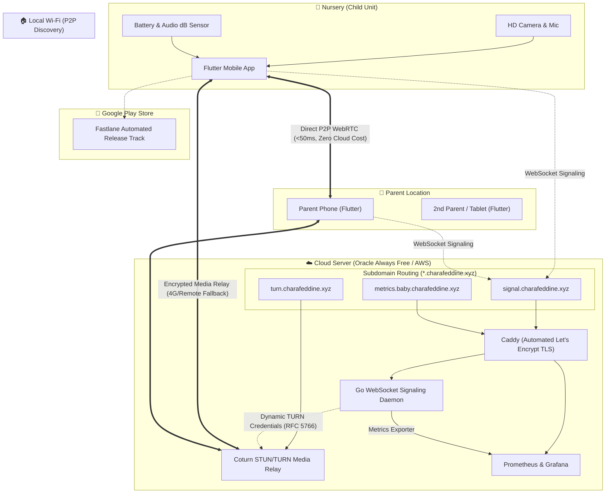

# 🍼 BabyMonitor — Enterprise DevOps & Flutter WebRTC Baby Monitor

[](https://github.com/charafeddine/baby_monitor/actions/workflows/ci-flutter.yml)
[](https://github.com/charafeddine/baby_monitor/actions/workflows/ci-cd-backend.yml)
[-blue.svg?logo=docker)](https://github.com/charafeddine/baby_monitor/pkgs/container/baby-monitor-signaling)
[-7B42BC.svg?logo=terraform)](terraform/)
[](LICENSE)
[](docs/security.md)

An open-source, commercial-grade **Baby Monitor application** built with **Flutter** (Android & iOS) and a high-performance **Go WebRTC Signaling Server**. It delivers every feature found in top paid subscription apps ($50/year apps like Annie, Bibino, Cloud Baby Monitor)—completely free, with zero ads, and engineered to showcase senior-level **DevOps, Cloud Platform, and Mobile Engineering**.

---

## 🏗️ System Architecture



---

## 🌟 Feature Matrix: Paid Commercial Features (100% Free)

| Feature | BabyMonitor (This App) | Typical Paid Apps ($40-60/yr) |
| :--- | :---: | :---: |
| **Subscription / Ads** | **100% Free / Zero Ads** | $4.99/mo or $49/yr + Ads |
| **Ultra-Low Latency Video** | **Sub-second (<200ms) WebRTC** | 2 - 5s Latency (HLS/RTMP) |
| **Direct Local Wi-Fi P2P** | **Yes (mDNS/Zeroconf - works offline)** | Rarely (routes via cloud) |
| **Two-Way Audio (Talkback)** | **Yes (Push-to-Talk Walkie-Talkie)** | Paywalled |
| **Noise & Cry Detection** | **Yes (Real-time dB audio meter & alert)** | Paywalled |
| **Background Audio Listening** | **Yes (Screen-off Foreground Service)** | Paywalled |
| **Lullabies & White Noise** | **Yes (Built-in offline sounds + timer)** | Paywalled |
| **Remote Flashlight / Night Light** | **Yes (Remotely toggled by parent)** | Paywalled |
| **Battery & Charging Monitor** | **Yes (Live telemetry on parent screen)** | Often Missing |
| **Multi-Parent Simultaneous View** | **Yes (Mom + Dad can watch together)** | Paywalled |
| **Privacy & Security** | **E2EE (DTLS-SRTP, zero data saved)** | Account tracking / cloud storage |

---

## 🛠️ DevOps & Cloud Engineering Highlights

This repository demonstrates complete production DevOps automation:

### 1. Infrastructure as Code (IaC) with Terraform
* **Oracle Cloud Always Free (Primary)**: Automatically provisions an Ampere A1 (ARM64) 4 OCPU, 24GB RAM instance, Virtual Cloud Network (VCN), and WebRTC UDP/TCP security lists, taking advantage of **10 TB/month free outbound data transfer**.
* **AWS Free Tier (Alternative)**: EC2, VPC, Internet Gateway, and Security Groups configuration.
* **Cloudflare DNS Management**: Automated provisioning of `signal.charafeddine.xyz`, `turn.charafeddine.xyz`, and `baby.charafeddine.xyz`.

### 2. Multi-Stage Distroless Docker Image
* Minimal multi-stage build (`golang:1.22-alpine` -> `gcr.io/distroless/static-debian12:nonroot`).
* Runs as unprivileged non-root user (`USER nonroot:nonroot`).
* Final container image size is **under 15 MB**.
* Multi-architecture build (`linux/amd64` and `linux/arm64`) using Docker Buildx in CI.

### 3. Automated Mobile CI/CD with Fastlane
* Android keystore decryption from base64 GitHub Secrets.
* Automated `.aab` (Android App Bundle) build and signing.
* Automated upload directly to **Google Play Console** Internal Testing & Closed Alpha tracks via Fastlane.

### 4. Continuous Integration & Security Scanning
* **Flutter CI**: Code formatting validation, static analysis (`flutter analyze --fatal-infos`), and unit/widget test coverage report.
* **Container Security**: Aqua Security **Trivy** scanning image for CVEs on every Pull Request.
* **Semantic Release**: Conventional Commits parsing (`feat:`, `fix:`, `chore:`, `perf:`), automatic Git tagging, and `CHANGELOG.md` generation.

### 5. Site Reliability Engineering (SRE) & Observability
* **Prometheus Metrics**: Exposes active rooms, peer sessions, message throughput, and connection durations on `/metrics`.
* **Health Probes**: Kubernetes/Docker-compliant `/healthz` and `/readyz` endpoints.
* **Pre-provisioned Grafana Dashboard**: Live visual monitoring of WebRTC network load and server health.

---

## 📂 Repository Structure

```text
baby_monitor/
├── .github/
│   ├── workflows/
│   │   ├── ci-flutter.yml          # Flutter lint, format, widget tests, coverage
│   │   ├── cd-android.yml          # Fastlane build signed AAB & deploy to Play Store
│   │   ├── ci-cd-backend.yml       # Docker buildx multi-arch, Trivy scan, push to ghcr.io
│   │   └── release.yml             # Semantic release, auto changelog & Git tags
│   ├── PULL_REQUEST_TEMPLATE.md
│   └── dependabot.yml              # Automated security alerts & dependency bumps
├── apps/
│   └── mobile/                     # Flutter client (Android & iOS)
│       ├── android/
│       │   └── fastlane/           # Fastlane Fastfile, Appfile, Gemfile
│       ├── lib/
│       │   ├── core/               # WebRTC service, battery telemetry, mDNS, lullabies
│       │   ├── features/           # Home, Pairing (QR/PIN), Baby unit, Parent unit
│       │   └── main.dart
│       └── test/                   # Unit & Widget tests
├── backend/
│   ├── cmd/signaling/              # High-performance Go WebSocket Signaling Server
│   ├── internal/signaling/         # Room manager, RFC 5766 TURN tokens, Prometheus metrics
│   ├── Dockerfile                  # Multi-stage, distroless, non-root image (<15MB)
│   └── Makefile                    # Standard build, test, docker targets
├── deployments/
│   ├── docker-compose.prod.yml     # Signaling + Coturn + Prometheus + Grafana + Caddy
│   ├── coturn/turnserver.conf      # Coturn STUN/TURN configuration
│   ├── caddy/Caddyfile             # Automatic HTTPS reverse proxy
│   └── prometheus/                 # Prometheus scraper config
├── terraform/
│   ├── cloudflare/                 # DNS records for *.charafeddine.xyz
│   ├── oci/                        # Oracle Cloud Always Free ARM64 compute & VCN
│   └── aws/                        # AWS Free Tier EC2 & Security Group
├── web/
│   └── landing/                    # Showcase website & legal Privacy Policy
└── README.md
```

---

## 🚀 Quickstart & Local Development

### 1. Run the Backend Locally
```bash
cd backend
go test -v -race ./...
go run ./cmd/signaling
```
Access endpoints:
* Signaling WebSocket: `ws://localhost:8080/ws?peer_id=dev-1&room_id=test&role=parent`
* Health Check: `http://localhost:8080/healthz`
* Prometheus Metrics: `http://localhost:8080/metrics`
* TURN Credentials: `http://localhost:8080/api/turn-credentials`

### 2. Run the Production Stack with Docker Compose
```bash
cd deployments
docker compose -f docker-compose.prod.yml up -d
```

### 3. Run the Flutter Mobile App
```bash
cd apps/mobile
flutter pub get
flutter test
flutter run
```

---

## 🔒 Security & Privacy

1. **Media Encryption**: Audio and video streams are encrypted end-to-end via **DTLS-SRTP** (industry standard for WebRTC).
2. **Ephemeral TURN Tokens**: Coturn relay credentials expire automatically after 24 hours using HMAC-SHA1 shared secrets (RFC 5766), preventing bandwidth theft.
3. **Zero Storage**: Video frames and audio samples are processed strictly in RAM and never written to disk or database.

---

## 📄 License
This project is licensed under the MIT License - see the [LICENSE](LICENSE) file for details.
